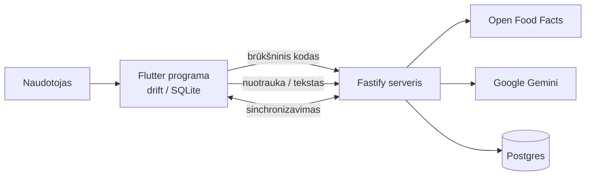

# Maisto sekimas: Food komponentas

Kursinio darbo I dalis: projektavimo dokumentas

## 1. Problema ir idėja

**Sistema vienu sakiniu:** Maisto sekimo sistema, kurioje valgį galima įrašyti ranka, pagal brūkšninį kodą arba pagal nuotrauką (AI), ir matyti dienos kalorijas bei makroelementus.

**Problema ir dabartinis procesas:** Maistą sekantys žmonės produktus ieško ir suveda ranka, tai ilgai trunka. Vieši duomenys (Open Food Facts) turi spragų, o AI įvertinimai būna netikslūs.

**Nauda:** Greitesnis įrašymas trimis būdais ir dienos suma iš karto matoma prieš tikslą.

**Naudotojai:** Asmuo, sekantis savo mitybą. Įrašo valgius, mato dienos sumą ir likutį iki tikslo, tvarko savo produktų biblioteką.

**Prielaidos:**
- Kiekvienas naudotojas pats nustato dienos tikslą.
- AI įvertinimas yra apytikslis, o naudotojas gali jį pataisyti.

## 2. Apimtis

| Funkcija | Ką naudotojas galės atlikti | Pagrindinis modulis ar pagalbinė funkcija |
|---|---|---|
| Įrašas ranka | Įvesti pavadinimą, maistinę vertę. | Pagrindinis modulis |
| Brūkšninis kodas | Nuskenuoti kodą ir gauti produkto vertes iš interneto | Pagrindinis modulis |
| AI nuotraukos įvertinimas | Nufotografuoti valgį (ir pasirinktinai pridėti tekstą) ir gauti maistinę vertę | Pagrindinis modulis |
| Produktų biblioteka | Išsaugoti produktus (vertės 100 g) ir naudoti pakartotinai | Pagalbinė |
| Dienos tikslai ir suma | Nustatyti dienos tikslą, matyti dienos sumą, likutį. | Pagalbinė |

**Į kursinio darbo apimtį neįeina:** paskyrų kūrimas, šiame etape nevertinamas sinchronizavimas tarp įrenginių.

## 3. Pagrindinis modulis

**Pavadinimas ir atsakomybė:** „Valgio įrašo sudarymas“. Iš trijų šaltinių (ranka, brūkšninis kodas, AI) gauna maistinę vertę ir paverčia ją valgio įrašu.

**Logika, kurią reikės projektuoti ir testuoti:** vertės skaičiavimas pagal gramus, brūkšninio kodo paieška, AI atsakymo apdorojimas ir neigiamų reikšmių korekcija.

**Įvestis:** maistinė vertė ir gramai; arba brūkšninis kodas ir gramai; arba nuotrauka ir/arba tekstas. Pavyzdys: produktas 250 kcal / 100 g, 150 g.

**Išvestis:** valgio įrašas: pavadinimas, maistinė vertė, šaltinis (`manual`, `barcode`, `ai`). Pavyzdys: 375 kcal, B 15, A 45, R 15.

**Veikimo eiga:**
1. Naudotojas pasirenka šaltinį.
2. Sistema gauna vertes (įvesta ranka, iš bibliotekos / interneto, arba iš AI).
3. Pritaiko taisykles R1–R4.
4. Įrašas išsaugomas valgyje ir įtraukiamas į dienos sumą.

### Taisyklės arba sprendimo žingsniai

1. **R1, skaičiavimas pagal gramus.** Vertė = `round(vertė_100g · gramai / 100)`. Valgio suma yra tik jo įrašų suma.
2. **R2, brūkšninio kodo paieška.** Kodas turi atitikti 6–14 skaitmenų. Pirmiausia ieškoma vietinėje bibliotekoje, tada internete. Trūkstamos vertės lieka tuščios (ne 0). Jei yra tik kJ, kcal = kJ / 4,184. Produkto nėra: „No product with that barcode“. Tinklo klaida arba netinkamas atsakymas: klaida 502.
3. **R3, AI atsakymo ribos.** Atsakymas privalo būti JSON pagal schemą. Viršutinių ribų nėra, reikšmės negali būti neigiamos (kcal, baltymai, angliavandeniai, riebalai ne mažiau nei 0, porcija ne mažiau nei 1 g). Neigiama reikšmė pakeičiama minimumu. Nevalidus JSON yra klaida (502) ir nieko neišsaugoma. Jei nuotrauka ne maistas, grąžinama „Not food“ su nuliais ir patikimumu low.
4. **R4, AI iškvietimo gedimai.** Bandymas 30 s, nepavykus bandomas kitas modelis.

### Scenarijai būsimiems testams

| Scenarijus | Pradinės sąlygos ir konkreti įvestis | Veiksmas | Tikslus laukiamas rezultatas |
|---|---|---|---|
| Įprastas atvejis | Bibliotekos produktas 250 kcal, B 10, A 30, R 10 (100 g) | Įrašyti 150 g | 375 kcal, B 15, A 45, R 15. Dienos suma +375 |
| Ribinis: AI grąžina neigiamą reikšmę | AI grąžina kcal −50, porcija 0 | Apdoroti atsakymą | kcal 0, porcija 1. Įrašas šaltinis `ai` |
| Ribinis: tik kJ | Open Food Facts produktas turi tik 1046 kJ / 100 g | Ieškoti kodo | 250 kcal / 100 g |
| Klaida: nėra produkto | Kodas 4000000000000, Open Food Facts jo neturi | Ieškoti kodo | „No product with that barcode“, įrašas nesukuriamas |
| Klaida: AI nepasiekiamas | Visi modeliai grąžina klaidą arba neatsako per 30 s | Siųsti nuotrauką | Rodoma klaida, įrašas nesukuriamas |

**Jei modulis naudoja AI:**
- **Įvestis:** nuotrauka sumažinama (ilgesnė kraštinė 1024 px, ≤ 4 MB), tekstas ≤ 280 simbolių. Reikia nuotraukos arba teksto.
- **Atsakymo tikrinimas:** JSON schema ir neigiamų reikšmių korekcija (R3). Rezultatas įrašomas su šaltiniu `ai`, bibliotekoje pažymimas kaip AI įvertintas.
- **Netinkamas rezultatas:** nevalidus JSON arba gedimas nieko neišsaugo, rodomas klaidos pranešimas.
- **Kokybės vertinimas:** 20 nuotraukų su žinomomis kalorijomis (iš etikečių), matuoju medianinę procentinę paklaidą. Tikslas yra išmatuoti paklaidą.

## 4. Kokybės atributas

**Pasirinktas atributas:** patikimumas (blogas AI atsakymas ar AI gedimas nepakenkia duomenims).

**Kodėl svarbus šiai sistemai:** AI atsakymas gali būti blogo formato, su neteisingomis reikšmėmis arba iš viso negauti. Naudotojas nenori, kad toks atsakymas sugadintų jo dienos sumą.

**Tikrinimo scenarijus ir sąlygos:** Modelio atsakymai su nevalidžiu JSON ir neigiamomis reikšmėmis, taip pat situacija, kai AI nepasiekiamas.

**Sėkmės kriterijus:** Iš 20 įrašytų atsakymų (įskaitant sugadintus) nė vienas nevalidus nepatenka į duomenų bazę, o neigiamos reikšmės pakeičiamos minimumu. Kai AI nepasiekiamas, įrašas nesukuriamas ir rodoma klaida (10 iš 10 bandymų).

**Numatytas projektavimo sprendimas:** Atsakymo patikra serveryje (schema ir minimumas), klientas ją dubliuoja. Gedimo atveju bandomas kitas modelis, o jei nepavyksta, nieko neįrašoma.

**Kaip patikrinsiu vėlesniame etape:** Serverio testai R2 ir R3 su įrašytais atsakymais ir 10 rankinių bandymų, kai AI nepasiekiamas.

**Sprendimo kaina arba ribojimas:** Serverio maisto logikai testų dar nėra, juos reikės parašyti.

## 5. Pradinė sistemos struktūra

### Paprasta schema

| Sistemos dalis | Atsakomybė |
|---|---|
| Flutter programa | Įrašų, bibliotekos ir tikslų UI, vietinė duomenų bazė |
| Fastify serveris | Brūkšninio kodo paieška, AI užklausos, atsakymo patikra, saugo AI raktą |
| Open Food Facts | Viešieji produktų duomenys pagal brūkšninį kodą |
| Google Gemini | Valgio įvertinimas iš nuotraukos arba teksto |
| Postgres | Duomenų kopija serveryje ir sinchronizavimas |

**Planuojamos technologijos ir pasirinkimo priežastys:** Naudoju tą patį steką kaip ir panašiame projekte: Flutter (Dart kalba) su drift (SQLite) ir Riverpod klientui, TypeScript su Fastify, Zod ir Postgres serveriui, Open Food Facts API, Google Gemini. Priežastis: jau turiu panašų projektą, kuriame šis stekas ir funkcionalumas veikia gerai.

## 6. AI panaudojimas

### AI rengiant šį dokumentą

| Priemonė ir užduotis | Ką panaudojau | Ką atmečiau arba perrašiau ir kodėl | Kaip patikrinau |
|---|---|---|---|
| Claude Code: perskaitė užduotį, šabloną ir mano panašaus projekto Food kodą, parašė juodraštį | Struktūrą, taisyklių ir scenarijų idėjas | Pataisiau idėjos netikslumus ir steko klaidas, pašalinau prototipui nereikalingą detalumą | Tikrinau, ar idėja aprašyta teisingai, ir sutikrinau su jau kitame projekte esamu steku |

### Planuojamas AI naudojimas kuriant sistemą

**Kur ir kam naudosiu AI:** testų ir kodo juodraščiams, klaidų paieškai.

**Kaip tikrinsiu pasiūlymus ir sugeneruotą kodą:** skaitau kiekvieną pakeitimą, paleidžiu testus, taisyklių pavyzdžius skaičiuoju ranka.

**Rizikos:** AI gali pasiūlyti klaidingą ar nesuprantamą kodą, o vėliau tai gali sukelti klaidų. Todėl nepriimu kodo, kurio negaliu paaiškinti, ir kiekvieną pakeitimą tikrinu testais. Taip. Gemini vertina valgį iš nuotraukos arba teksto, o sistema tikrina jo atsakymą (R3, R4).

## 7. Tolesnių darbų planas

| Darbas | Apčiuopiamas rezultatas | Planuojama darbų seka |
|---|---|---|
| Trijų įrašymo būdų paleidimas | Įrašas ranka, brūkšniniu kodu ir AI veikia ir sudaro dienos sumą | 1 |
| Serverio testai R2 ir R3 | Testai su įrašytais Open Food Facts ir Gemini atsakymais | 2 |
| Gedimo bandymai | 10 bandymų lentelė (AI nepasiekiamas) | 3 |
| Kokybės matavimas | 20 nuotraukų paklaidos lentelė | 4 |

**Būsimo prototipo veikimo scenarijus:** Įrašau valgį trimis būdais: ranka (150 g, 250 kcal / 100 g, tikimasi 375 kcal), brūkšniniu kodu (tikimasi Open Food Facts verčių) ir nuotrauka (tikimasi AI pasiūlymo). Dienos suma turi susidėti iš visų trijų įrašų.

| Rizika arba neaiškumas | Kaip patikrinsiu arba sumažinsiu |
|---|---|
| Open Food Facts duomenys neišsamūs arba klaidingi | Trūkstamos vertės lieka tuščios, galima įvesti ranka ir išsaugoti bibliotekoje |
| AI kvota arba tikslumas | Atsarginiai modeliai, klaidos pranešimas, paklaidos matavimas |

## Šaltiniai, jei naudojote

- Panašios paskirties asmeninis projektas GitHub platformoje (uždara, privati repozitorija).
- Open Food Facts API dokumentacija (world.openfoodfacts.org).

AI naudojimas aprašytas 6 skyriuje.

